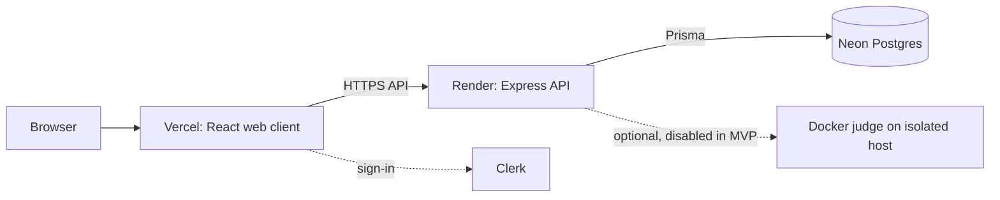

# Code Battle Arena

Code Battle Arena is a competitive-programming platform for browsing problems, writing solutions in the browser, and tracking a user's progress. The live MVP is available at [code-battle-arena-eg.vercel.app](https://code-battle-arena-eg.vercel.app).

## MVP status

The deployed MVP supports the problem catalog, problem statements, Clerk sign-in, a browser editor with per-problem drafts, and the account and progress views. The API uses PostgreSQL through Prisma and validates shared request and response contracts with Zod. Drafts are stored in the browser. Because execution is disabled, the live demo cannot create new judged submissions or advance solved-problem progress.

Code execution is intentionally disabled in the public MVP because there is no isolated judge host available yet. Run and submit actions explain that execution is unavailable; they do not claim to have judged code. Real-time battles, matchmaking, and a leaderboard are not implemented.

## Applications

| Package | Purpose | Runtime or host |
| --- | --- | --- |
| `apps/web` | React web client, problem catalog, editor, profile | Vite, Vercel |
| `apps/server` | HTTP API, authentication, problem and submission data | Express, Render |
| `apps/judge` | Isolated C++ compilation and execution | Bun, Docker, separate Linux host |
| `packages/shared` | Zod schemas and shared TypeScript contracts | Workspace package |
| Database | Users, problems, test cases, submissions, progress | PostgreSQL on Neon |
| Authentication | Sign-in and session tokens | Clerk |



The judge is a separate service because user-submitted programs need Docker isolation. It must not be deployed as a normal Render web service. The public API is configured with `JUDGE_ENABLED=false` until an isolated judge host is ready.

## Local development

### Requirements

- Node.js 24 or newer
- Bun 1.4.0
- Docker only if you want to run the judge integration tests or execute code locally
- PostgreSQL for problem and account data; Clerk credentials for authenticated flows

Install the workspace dependencies:

```bash
bun install --frozen-lockfile
```

Copy the examples to local environment files:

```bash
cp apps/web/.env.example apps/web/.env
cp apps/server/.env.example apps/server/.env
cp apps/judge/.env.example apps/judge/.env
```

Set the web variables in `apps/web/.env`:

| Variable | Local value |
| --- | --- |
| `VITE_API_URL` | `http://localhost:4000` |
| `VITE_WS_URL` | `ws://localhost:4000/ws` (reserved for future battle support) |
| `VITE_CLERK_PUBLISHABLE_KEY` | Clerk publishable key for the same instance as the server secret |

Set the server values in `apps/server/.env` when using the real database and authentication:

| Variable | Purpose |
| --- | --- |
| `DATABASE_URL` | Neon pooled PostgreSQL URL for application queries |
| `DATABASE_DIRECT_URL` | Direct PostgreSQL URL for Prisma migrations |
| `CLERK_PUBLISHABLE_KEY` | Publishable key matching the web client |
| `CLERK_SECRET_KEY` | Server-only Clerk secret key |
| `CORS_ORIGINS` | Allowed browser origins, for example `http://localhost:5173` |
| `JUDGE_ENABLED` | Set to `false` when no local judge is running |

Keep real values in local environment files. Do not put server or judge secrets in `apps/web/.env`, a Vite variable, source code, or Git.

Start the workspace:

```bash
bun run dev
```

The web client listens on `http://localhost:5173`, the main API on `http://localhost:4000`, and the optional judge on `http://localhost:3001`. If you enable the local judge, build its runner image before using it:

```bash
docker build -t cpp-runner .
```

The judge runs untrusted code. Its Docker configuration applies resource limits, removes capabilities, disables networking, and uses read-only filesystems. Use an isolated Linux environment and do not expose a local judge directly to the public internet. The implementation is in [`apps/judge/src/sandbox.ts`](apps/judge/src/sandbox.ts).

## Useful checks

```bash
bun run typecheck
bun run lint
bun run test
bun run build
bun run format:check
```

The Docker-backed judge suite requires Docker:

```bash
bun run test:integration
```

The server's PostgreSQL integration tests require a disposable PostgreSQL database on the same machine, configured with `TEST_DATABASE_URL`. The command checks that the database host is local and uses that URL for migrations and tests, so it will not apply test migrations to Neon:

```bash
bun run --cwd apps/server test:integration
```

Never point integration tests at production data. Prisma schema changes use committed migrations; apply them deliberately with `bun run --cwd apps/server db:migrate` after verifying the target database.

## Deployment

The current deployment uses Vercel for the web client, Render for the API, Neon for PostgreSQL, and Clerk for authentication. The API and web client have separate environment variables.

### Vercel

Configure the project to build `apps/web` and set:

| Variable | Value |
| --- | --- |
| `VITE_API_URL` | HTTPS origin of the Render API, not the Vercel frontend URL |
| `VITE_CLERK_PUBLISHABLE_KEY` | Clerk publishable key for the same Clerk instance as the API |

`VITE_WS_URL` is reserved for future battle support and is not used by the current MVP.

The SPA rewrite in `apps/web/vercel.json` serves the app for direct navigation to client-side routes.

### Render

Create the API from the repository's `render.yaml` Blueprint, keeping the repository root as the service root. The Blueprint selects Render's free plan. Configure `DATABASE_URL`, `DATABASE_DIRECT_URL`, `CLERK_PUBLISHABLE_KEY`, and `CLERK_SECRET_KEY` in Render's environment settings. Keep `CORS_ORIGINS` set to the exact Vercel origin, without a trailing slash. Leave `JUDGE_ENABLED=false` until a separately hosted judge is ready. Render's free service may sleep when idle, so the first request after inactivity can be slow.

Check `/health` for process health and `/ready` for database readiness. Apply Prisma migrations from a trusted environment with the intended direct database URL; migrations do not run as part of the service build.

### Neon and Clerk

Use Neon pooled `DATABASE_URL` for runtime requests and direct `DATABASE_DIRECT_URL` for migrations. Use matching Clerk keys in Vercel and Render: only the publishable key belongs in the web build; the secret key stays on the server. Development Clerk instances are appropriate for a small demo, with Clerk's development limits and branding behavior.

### Enabling the judge later

Provision a separate Linux host with Docker and the required isolation controls, deploy `apps/judge` there, and configure the same strong `JUDGE_SECRET` on the judge and API. Then set the API's `JUDGE_URL` to its HTTPS endpoint and `JUDGE_ENABLED=true`. Run the security and malicious-input suites before accepting public submissions. Do not enable execution on Render or point the API at an unauthenticated judge.

## Project roadmap

- **Implemented:** monorepo and CI foundations, API and database schema, Clerk integration, problem catalog and importers, browser problem list and workspace, account/progress screens, submission APIs, and judge sandbox essentials.
- **MVP limitation:** public execution is disabled until a separately hosted judge is available. Full M1 performance certification and the complete M5 accessibility/Lighthouse targets remain open.
- **Not implemented:** live duels, matchmaking, spectators, group rooms, and leaderboard.

Detailed milestone notes, internal documentation, and agent instructions stay local and are intentionally kept out of GitHub; this README is the public project overview.

## License and problem data

Problem statements and test data retain their source attribution and license metadata. Respect the original sources' terms when importing or redistributing problem content. The application source license has not been selected yet; do not assume problem-data licenses also license the application code.
