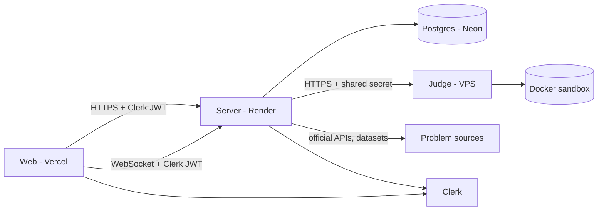

# ARCHITECTURE.md

## Overview



## Why the judge is a separate service

The judge starts Docker containers. Render web services do not expose a Docker daemon, and giving a public web service access to the Docker socket is the most dangerous setup possible (see `docs/SECURITY.md`). So:

- `apps/server` is a normal stateless-ish web service on Render. It never touches Docker.
- `apps/judge` runs on a small VPS with rootless Docker. It exposes one internal API and accepts only requests carrying a shared secret.
- If a VPS is not wanted, swap the judge for Judge0 or Piston behind the same `runOnJudge` function in the server. The server code does not care.

## Monorepo

```text
apps/
  web/        React client
  server/     main API, battles, importers
  judge/      sandboxed execution (the original engine)
packages/
  shared/     zod schemas, types, constants used by web and server
```

## Server layout

```text
apps/server/src/
  index.ts          boot, http + ws
  env.ts            zod-validated env
  app.ts            express app, middleware
  routes/           one file per resource
  db/               drizzle schema, queries, migrations
  services/         judge client, problems import, battles, rating
  importers/        one adapter per problem source
  ws/               socket server, room state
```

## Main flows

Submit a solution:

1. Web posts code to `POST /api/problems/:slug/submit` with the Clerk token.
2. Server verifies the user, loads test cases from Postgres, rate-limits.
3. Server calls the judge with code and tests, gets verdicts back.
4. Server stores the submission and updates progress, returns the result.
5. In a battle, the server also updates the battle score and broadcasts over WebSocket.

Import problems: admin triggers an import, the runner calls each adapter, upserts problems and tests, records an `import_runs` row. See `docs/PROBLEMS.md`.

Battle: server-authoritative state machine over WebSocket. See `docs/BATTLE.md`.

## Boundaries

| Component | Owns                           | Never does                             |
| --------- | ------------------------------ | -------------------------------------- |
| web       | UI, animations, editor         | trust itself on scores or time         |
| server    | auth, data, battles, importing | run user code, talk to Docker          |
| judge     | compile, run, verdicts         | know about users, problems, or battles |
| shared    | schemas and types              | contain logic with side effects        |

## Judge internals

Current M0 implementation: compile once in Docker, start a container per test, compare trimmed output, clean up temporary files in `finally`. The shim, one-container execution, reliable container cleanup, and complete sandbox restrictions are planned for M1. Details in `docs/SECURITY.md`, `docs/PERFORMANCE.md`, `docs/JUDGE_API.md`.

The legacy endpoint keeps the first non-`AC` verdict in test order. Proposed precedence (`IE` > `CE` > `TLE` > `MLE` > `OLE` > `RE` > `WA` > `AC`) is for a future versioned contract, not a silent change to the existing endpoint.

## Scaling notes

- Battle room state lives in memory of one server instance at first. One Render instance is enough for a faculty-sized audience. If it ever needs more than one instance, move room state to Redis and add sticky sessions or pub/sub. Do not build that now.
- The judge scales by adding workers behind the same URL, with a queue per worker.
- Free tiers: Render free instances sleep, which breaks WebSockets and cold-starts the API. Use a paid instance for the demo.
